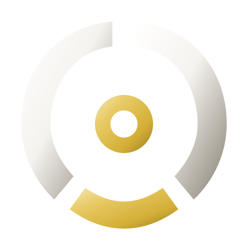

# 💎 OmniWealth (v2.0)
### *Personal Multi-Asset Wealth & True Net Worth Intelligence*

[](https://github.com/JustPras/omniwealt/actions/workflows/build-native-apk.yml)
[](https://github.com/JustPras/omniwealt)
[](README.md#-%EF%B8%8F-keamanan--privasi-data)
[](https://github.com/JustPras/omniwealt)
[](https://reactnative.dev/)
[](https://expo.dev/)
[](https://www.typescriptlang.org/)
[](README.md)

---

<p align="center">
  
</p>

<p align="center">
  <b>Aplikasi pelacak total kekayaan bersih (True Net Worth) multi-aset pribadi generasi modern.<br/>
  Mengintegrasikan Kas Perbankan, E-Wallet, Saham IDX & RDN, Kripto, dan Liabilitas dalam antarmuka berkelas <i>Warm Titanium & Champagne Liquid Glass</i>, parser mutasi on-device AI & PDF broker statement reader, serta kalkulasi neraca saldo presisi.</b>
</p>

<p align="center">
  $$\mathbf{True\ Net\ Worth} = \mathbf{Total\ Aset}\ (\text{Kas} + \text{Saham} + \text{Kripto}) - \mathbf{Total\ Liabilitas}\ (\text{Tagihan} + \text{Hutang})$$
</p>

---

## 🎨 Desain Sistem: *Warm Titanium & Champagne Liquid Glass*

OmniWealth mengusung filosofi desain mutakhir yang menggabungkan estetika **Warm Titanium & Champagne Liquid Glass** (terinspirasi oleh *Swiss Private Banking & Bullion Vault*):

| Token Desain | Spesifikasi | Detail Penerapan |
|---|---|---|
| **Canvas / Background** | `#0A0A09` (Warm Carbon OLED) | Kanvas hitam arang dengan tone hangat mewah ramah layar OLED & minim eye-strain |
| **Titanium Spectrum** | `#F5F3EF` / `#A39E93` | Aksen brushed natural titanium pada typography, data labels & iconography |
| **Champagne Bullion Gold** | `#D4AF37` / `#F2CA50` | Primary jewel color untuk hero net worth, accents, badge, dan visual highlights |
| **Asymmetric Specular Rim** | `1px top-left specular border` | Garis pantulan kristal pada sudut kiri-atas (`rgba(212,175,55,0.22)`) |
| **Quartz & Bullion Card Glass** | `.quartz-card` & `.hero-bullion-card` | Elevasi kartu kaca kuarsa dengan latar `#131311`, border asimetris & blur optik |
| **Dual Typography** | `Plus Jakarta Sans` & `JetBrains Mono` | Sans-serif modern berkelas dipadukan dengan tabular-nums monospaced presisi |
| **Motion Choreography** | Fluid Circular Arc Draw-on | Animasi loading elegan: 360° donut sweep + symmetrical outer arcs sweep |
| **Brand Mark** | *Bullion Nexus* (Pure Gold & Titanium) | Lambang vektor transparan murni bersudut presisi tanpa kotak solid |

---

## ⚡ Fluid Circular Arc Draw-on Loading Motion

Indikator animasi loading OmniWealth dirancang dengan transisi kurva matematika fluida (`assets/motion/logo_motion.html`, `LogoLoader`, dan `LuxuryLoader`):
- **Center Donut Sweep:** Rotasi busur cincin emas `#D4AF37` dengan stroke melingkar 360° mulus (`stroke-dasharray`, `stroke-dashoffset`).
- **Symmetrical Outer Arcs Sweep:** Busur lengkung ganda titanium `#F5F3EF` & `#A39E93` yang memanjang dari bawah ke atas secara simetris mengapit inti emas.
- **Ambient Aura Glow:** Efek pendaran cahaya champagne halus (`rgba(212, 175, 55, 0.22)`) yang bernapas lembut mengikuti siklus loading.

---

## 🚀 Fitur-Fitur Utama (4 Pilar Finansial)

### 1. 🏛️ Pilar 1: Kas Perbankan & E-Wallet (Liquid Cash)
- **Multi-Akun Terpadu:** Kelola rekening bank nasional (BCA, Mandiri, BRI, BNI, Bank Jago) dan dompet digital (GoPay, OVO, DANA, ShopeePay).
- **Parser Mutasi AI (Gemini Flash & Regex Fallback):** Ekstraksi instan dari notifikasi SMS/Push Notification perbankan atau teks mutasi QRIS tanpa perlu input manual.
- **Deteksi Transfer Internal Cerdas:** Menghubungkan transaksi transfer antar-rekening pribadi secara otomatis tanpa menggandakan pencatatan saldo.

### 2. 📈 Pilar 2: Pasar Modal & Saham IDX (Capital Equities)
- **Ekosistem Saham Indonesia (BEI):** Mendukung seluruh emiten IDX (`BBCA.JK`, `BMRI.JK`, `TLKM.JK`, dll.) dalam satuan **Lot** (1 Lot = 100 lembar).
- **Normalisasi Instrumen Turunan:** Deteksi otomatis instrumen Warrant (`-W`, `-W2`) dan Right Issue (`-R`) dengan rekalibrasi *Average Buy Price* akurat.
- **In-Memory PDF Statement Parser:** Membaca dokumen resmi *Trade Confirmation* dan *Statement of Account (SoA)* broker (Stockbit, IPOT, Ajaib, Mirae) langsung di memori perangkat dengan dekompresi *FlateDecode*.
- **Otomatisasi Kas RDN:** Pembelian saham otomatis memotong saldo kas RDN; penjualan saham dan dividen tunai langsung menambah saldo kas RDN.

### 3. 🌐 Pilar 3: Web3 & Aset Kripto (Alternative Assets)
- **Multi-Chain Address Validator:** Deteksi otomatis jaringan blockchain (EVM/Ethereum/Polygon, Solana, dan Bitcoin) langsung dari alamat publik.
- **Smart Batch Extract:** Ekstraksi multi-alamat sekaligus dari teks bebas.
- **Valuasi Real-Time (IDR & USD):** Konversi nilai pasar aset kripto (BTC, ETH, SOL) dengan mekanisme *offline fallback*.

### 4. 💳 Pilar 4: Liabilitas & Manajemen Utang (Liabilities)
- **Pencatatan Kewajiban:** Kartu kredit, cicilan paylater, dan pinjaman/KPR.
- **Rasio Utilisasi Kredit (CUR):** Peringatan dini jika penggunaan limit kredit melebihi ambang batas sehat (30%).
- **Due Date Alerts:** Pengingat otomatis tanggal jatuh tempo tagihan.
- **Pelunasan Atomik:** Pembayaran tagihan langsung memotong saldo rekening kas sumber dan mengurangi sisa pokok utang.

---

## 🛡️ Keamanan & Privasi Data

> [!IMPORTANT]
> Proyek ini menerapkan prinsip **Zero Telemetry** dan **Local-First Privacy**:
> - **100% Bebas Hardcoded Keys:** Seluruh integrasi API (Google Gemini & Supabase) diatur murni via environment variable (`process.env.EXPO_PUBLIC_*`).
> - **Penyimpanan Terenkripsi Lokal:** Riwayat mutasi, dokumen statement, lot saham, dan portofolio Anda tersimpan di penyimpanan internal perangkat (`AsyncStorage`). Tidak ada data finansial yang dikirim ke server pihak ketiga.
> - **Audit Keamanan Berkelanjutan:** Repositori telah diaudit secara menyeluruh terhadap kebocoran kredensial, token JWT, maupun data pribadi (PII).
> - **Privacy Shield Satu Sentuhan:** Sensor privasi instan pada header bar menyamarkan seluruh nominal angka menjadi `Rp ••••••••` saat membuka aplikasi di ruang publik.

---

## 🛠️ Arsitektur & Teknologi

```
omniwealth-v2/
├── app/                           # File-based Navigation (Expo Router v4)
│   ├── _layout.tsx                # Root layout, theme controller & ambient background
│   └── (tabs)/                    # Floating bottom navigation tabs
│       ├── _layout.tsx            # Floating Capsule Bottom Bar (min-height 100dvh, safe-area padding)
│       ├── index.tsx              # Tab 1: Overview Dashboard (Hero Bullion Card, Bento Grid 01-04)
│       ├── accounts.tsx           # Tab 2: Kas Perbankan & Mutasi AI
│       ├── portfolio.tsx          # Tab 3: Saham IDX, RDN & Kripto
│       └── sync.tsx               # Tab 4: Dual Dropzone Statement Ingestion & LogoLoader
│
├── src/                           # Core Logic, Components & Services
│   ├── components/
│   │   ├── common/                # GlassCard, AmbientBackground, LogoLoader, LuxuryLoader, Icon
│   │   ├── layout/                # HeaderBar (Capsule glass, Local AI ready status)
│   │   └── modals/                # Modal Form (Account, Stock, Crypto, Mutasi, SoA, Liability)
│   ├── constants/
│   │   └── initial-data.ts        # Synthetic demo data fixtures
│   ├── services/
│   │   ├── ai-parser.ts           # Gemini Flash OCR + Deterministic Regex Engine
│   │   ├── market-service.ts      # Live ticker & fallback engine
│   │   ├── storage-service.ts     # Offline-first AsyncStorage engine
│   │   └── rdn-pipeline/          # PDF extraction, reconciliation & warrant handlers
│   ├── store/
│   │   └── wealth-context.tsx     # State Manager, True Net Worth Math & Hydration
│   ├── theme/
│   │   ├── colors.ts              # Semantic Warm Titanium & Champagne Gold palette
│   │   └── tokens.ts              # Quartz card tokens (asymmetric specular rim, bullion glass)
│   ├── types/                     # TypeScript Strict Definitions
│   └── utils/                     # Format Rupiah/USD, lot math, haptics feedback
│
├── assets/
│   ├── brand-kit/                 # Master SVG (Dark/Light/Pure Gold), Favicon suite & Lockup
│   ├── motion/                    # logo_motion.html (Fluid Circular Arc Draw-on choreography)
│   ├── icon.png                   # Universal App Icon (1024×1024)
│   ├── adaptive-icon.png          # Android Adaptive Icon (1024×1024)
│   └── favicon.png                # Web Favicon (192×192)
│
├── supabase/                      # Optional Database DDL Schemas & Migrations
├── DESIGN_SYSTEM.md               # Spesifikasi lengkap Warm Titanium & Champagne Liquid Glass
├── tests/                         # Node.js Built-in Test Suite (42 Automated Tests)
└── .github/workflows/             # CI/CD GitHub Actions Build APK
```

- **Framework:** React Native 0.76.9 + Expo SDK 52
- **Engine:** Hermes JavaScript Engine + New Architecture
- **Routing:** Expo Router v4
- **Styling & Blur:** Custom Liquid Glass Engine + `expo-blur`
- **Offline Storage:** `@react-native-async-storage/async-storage`

---

## 🧪 Rangkaian Pengujian Otomatis (Unit Testing)

OmniWealth dilengkapi **42 unit test bawaan Node.js** (`node:test` & `node:assert`) tanpa ketergantungan framework berat:

```bash
npm test
```

```
TAP version 13
# Subtest: 1. Robust Number Parsing (Indonesian & International formats) - ok
# Subtest: 2. Parsing e-Statement BCA Tahapan & Rekonsiliasi Matematis - ok
# Subtest: 3. Parsing e-Statement Bank Jago Multi-Pocket - ok
# Subtest: 4. Deteksi Selisih Matematis pada Statement Rusak (NEEDS_REVIEW) - ok
# Subtest: 5. Deduplikasi Cerdas Notifikasi Buku Kas - ok
# Subtest: 6. Validasi Alamat Publik Multi-Chain (EVM, Solana, Bitcoin) - ok
# Subtest: 7. Perhitungan True Net Worth (Assets - Liabilities) - ok
# Subtest: 8. Rasio Utilisasi Kredit & Due Date Alerts - ok
# Subtest: 9. Deteksi Transfer Internal Dua Arah (Two-Legged Match) - ok
# Subtest: 10. Ekstraksi Notifikasi QRIS, BI-FAST, E-Wallet, & Top Up RDN - ok
# Subtest: 11. Dekompresi PDF Binary Streams FlateDecode - ok
# Subtest: 12. Rekalibrasi Average Buy Price Saham, Warrant, & Right Issue - ok
...
# Subtest: 42. Atomic Commit & Recalculate Portfolio Holdings untuk Warrant dan Right Issue - ok
1..42
# tests 42
# pass 42
# fail 0
# duration_ms 2329.93
```

---

## 💻 Panduan Menjalankan Secara Lokal

### Prasyarat
- [Node.js](https://nodejs.org/) v18, v20, atau v22
- npm atau pnpm
- Expo Go di smartphone atau Emulator Android/iOS

### 1. Kloning Repository
```bash
git clone https://github.com/JustPras/omniwealt.git
cd omniwealt
```

### 2. Konfigurasi Environment (Opsional)
Salin berkas template `.env.example` ke `.env`:
```bash
cp .env.example .env
```
*(Aplikasi tetap berfungsi 100% normal secara offline tanpa mengisi API key).*

### 3. Instalasi Dependensi
```bash
npm install --legacy-peer-deps
```

### 4. Menjalankan Aplikasi
```bash
# Mode Web (Preview Cepat di Browser)
npm run web

# Mode Android (Koneksi ke Smartphone / Emulator)
npm run android

# Menjalankan Test Suite
npm test
```

---

## 📱 Panduan Unduh APK Siap Pakai (Android)

APK Android dikompilasi secara otomatis oleh **GitHub Actions CI/CD**:
1. Buka tab **[Actions di Repository](https://github.com/JustPras/omniwealt/actions)**.
2. Klik alur kerja terbaru (**Build Native Android APK**).
3. Unduh berkas **`OmniWealth-TrueNative-Android-APK`** pada bagian *Artifacts*.
4. Pasang berkas `.apk` pada perangkat Android Anda.

---

## ⚖️ Hak Cipta & Lisensi

Proyek ini adalah **perangkat lunak kepemilikan pribadi (*Private & Proprietary Project*)** yang dikembangkan oleh **[@JustPras](https://github.com/JustPras)**.

**Hak Cipta Dilindungi Undang-Undang (*All Rights Reserved*).**  
Kode sumber, aset visual, logo, dan desain aplikasi ini tidak diizinkan untuk didistribusikan ulang, dikloning untuk tujuan komersial, atau dipublikasikan kembali tanpa izin tertulis dari pemilik proyek.
